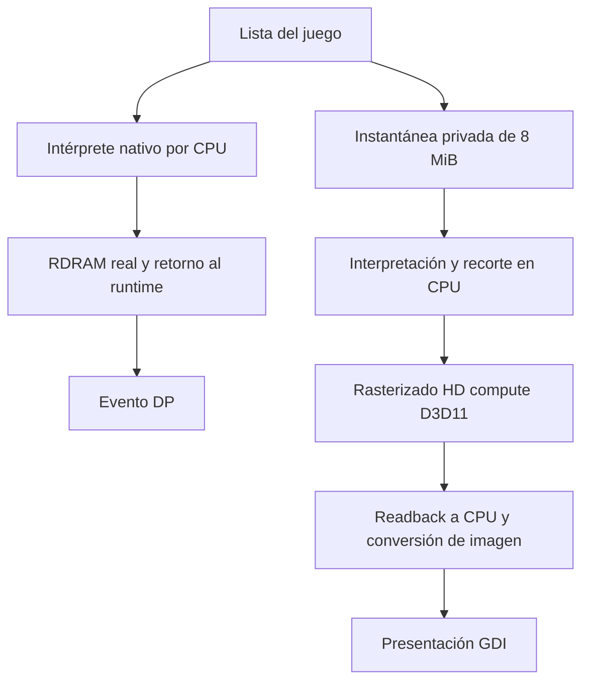

# Comparación de renderizadores y estrategia del port

Fecha: 2026-10-21. Análisis de fuentes y resultados locales ya existentes.
No se ejecutó un port ajeno ni un benchmark nuevo para esta comparación.
La revisión GPU local posterior a preview.6 sigue sin publicarse.

## Conclusión

Podemos basarnos en la arquitectura de los ejemplos de Mario Kart/Zelda y Wave
Race: un adaptador de renderer, configuración gráfica separada y presentación
por GPU. Para Top Gear conviene mejorar primero el backend D3D11 que ya dibuja
correctamente las escenas comprobadas, manteniendo el renderer nativo como
referencia. RT64 merece un prototipo separado antes de decidir una migración.

Hay una corrección importante respecto de la explicación inicial: RT64 también
contempla un renderer nativo y otro de mayor resolución para conservar las
lecturas de memoria del juego. La duplicación no demuestra por sí sola un error
de arquitectura. Nuestra diferencia principal es el rasterizado nativo por CPU,
la recreación de recursos y el retorno de la imagen HD a CPU para presentarla.
Fuente: [arquitectura oficial de RT64](https://github.com/rt64/rt64#architecture).

## 1. Qué hacen los otros ports y qué aprovechar

| Referencia revisada | Implementación observada | Aplicación a Top Gear |
| --- | --- | --- |
| MarioKart64Recomp, copia local | `RT64Context` adapta `RendererContext`. Carga el microcódigo del OSTask y entrega las listas a RT64. Ajusta resolución/multiplicador y downsampling, y presenta mediante `updateScreen`. | Usar la misma separación entre host, backend y configuración. Es el ejemplo local más claro para el contrato con nuestro runtime. |
| Zelda64Recomp, fuente oficial | Su adaptador convierte las preferencias del host a opciones de RT64 y consulta la presentación del backend. | Referencia del puente con RT64; no trasladar sus parches de juego, UI o políticas de aspecto/LOD sin revisar. |
| wave-race-64-recomp, copia local | Adaptador pequeño: normaliza direcciones físicas, selecciona microcódigo y llama `processDisplayLists`/`updateScreen`. `get_resolution_scale()` devuelve 1 y `enable_instant_present()` está pendiente. | Buen ejemplo para iniciar el puente; esa copia no es una plantilla completa de todas las mejoras gráficas. |
| RaceWave46, copia local | Integra RT64 con configuración, trazas, procedencia de tareas y diagnóstico de VI. Tiene extensiones particulares de Wave Race y cambios dentro de su copia de RT64. | Adoptar trazas de tarea/VI y configuración; usar un upstream fijado y parches explícitos en una futura integración. |
| Ship of Harkinian, fuente oficial | El editor de resolución maneja píxeles verticales, aspecto y escalado entero como opciones distintas, mediante su framework Fast/libultraship. | Referencia de interfaz y persistencia. Su framework no sustituye directamente el contrato `RendererContext` del runtime que usamos. |

Fuentes oficiales concretas:

- [Adaptador de Zelda64Recomp](https://github.com/Zelda64Recomp/Zelda64Recomp/blob/dev/src/main/rt64_render_context.cpp).
- [Editor de resolución de Shipwright](https://github.com/HarbourMasters/Shipwright/blob/develop/soh/soh/SohGui/ResolutionEditor.cpp).
- [Dependencias declaradas de Shipwright](https://github.com/HarbourMasters/Shipwright/blob/develop/.gitmodules).

Evidencia local revisada, relativa a la raíz del workspace de investigación:
`ejemplos/MarioKart64Recomp/src/main/rt64_render_context.cpp`,
`ejemplos/wave-race-64-recomp/src/renderer.cpp`,
`ejemplos/RaceWave46/src/rt64_renderer.cpp` y
`ejemplos/RaceWave46/lib/rt64/src/gbi/`. Estos ejemplos no son dependencias del
árbol público ni son necesarios para compilar Top Gear.

## 2. Compatibilidad de RT64: el punto específico de Top Gear

En el RT64 incluido en RaceWave46, `GBI_L3DEX2::line3D` contiene `assert(false)`.
La tabla identifica L3DEX2 FIFO 2.05, con comentarios de confirmación pendiente.
Reconocer un microcódigo no significa implementar sus comandos. Nuestro juego
cambia entre F3DEX2 y L3DEX2, y nuestra corrección de preview.5 implementó LINE3D
más las aristas de TRI1/TRI2 bajo L3DEX2.

Por tanto, integrar esa copia sin adaptar líneas puede producir un assert en
builds con aserciones o descartar dibujo al quitarlas. También deben comprobarse
los cambios LOAD_UCODE y la semántica de triángulos/aristas de ese microcódigo.
La fuente F3DEX2 oficial consultada mantiene `line3D` como TODO:
[código oficial](https://github.com/rt64/rt64/blob/main/src/gbi/rt64_gbi_f3dex2.cpp).
No se afirma que todas las versiones/forks de RT64 carezcan de soporte; hay que
revisar y fijar la revisión exacta que se vaya a integrar.

Otros puntos de aceptación: máscaras 15 en bandas COPY 320x6 de la intro,
profundidad y mezcla del HUD/humo, offsets VI y targets 640, TLUT/TMEM, reflejos,
readback y las variaciones de microcódigo observadas. RT64 puede mejorar fidelidad,
pero no se ha medido ni confirmado esa mejora para Top Gear.

## 3. Recorrido actual y trabajo evitable

La rama HD es asíncrona: sus tiempos no se suman automáticamente a los de la rama
nativa. Las dos ramas compiten por recursos del equipo, y copiar la instantánea
sí forma parte del trabajo antes de retornar al runtime.

| Lugar del código propio | Trabajo comprobado en fuentes | Mejora posible |
| --- | --- | --- |
| `process_graphics_task`, `src/main.cpp` | Rasteriza siempre la lista nativa antes de retornar. | Conservar durante las primeras etapas; estudiar después un renderer nativo GPU con readback correcto. |
| `AsyncHDRenderer::submit` | Copia 8 MiB por tarea y conserva un pendiente máximo. | Reutilizar almacenamiento y medir captura/espera; reducir copias solo con evidencia de que los datos se conservan. |
| `GPURaster::begin_frame`/`surface` | Descarta superficies y vuelve a crear buffers/vistas/staging; importa el contenido inicial desde CPU. | Reutilizar asignaciones por dirección/dimensiones y generación. La vigencia de contenidos se debe comprobar por separado. |
| `GPURaster::flush` | Crea listas por bloques y cuatro buffers/vistas de entrada por lote. | Reutilizar capacidad y recursos; medir construcción y upload por separado. |
| `GPURaster::readback` y fin de lista | Descarga las superficies modificadas y espera `Map` en el trabajador. | Mantener readbacks necesarios para texturas/feedback; evitar la descarga final de pantalla cuando se presente directamente en GPU. |
| `copy_scanout`, `PresentedFrame`, `rgba` | Varias copias y conversión de 16 a 32 bits en CPU. | Entregar un recurso GPU con identidad de cuadro, dimensiones, recorte y generación. |
| `Win32RendererContext::update_screen` | Presenta con `StretchDIBits`. | Swapchain DXGI y presentación en GPU, conservando proporción/filtro y ruta de recuperación. |

En 1440x1080 un buffer GPU de uint32 ocupa 6,22 MB decimales. Si se descargan
color y profundidad completos son unos 12,44 MB por cuadro, antes de las copias
CPU posteriores. Es un cálculo de volumen, no una medición de PCIe ni evidencia
de que GDI sea hoy el mayor cuello de botella.

## 4. Qué permiten concluir las mediciones existentes

- Misma lista de carrera: CPU 326/726 ms y GPU 12,3/12,2 ms a 720p/1080p.
- Recorridos separados de 30 s: media de trabajo HD 9,1/14,4 ms; media nativa
  30,746/30,604 ms, con escala lógica 1.
- Edad final de la instantánea presentada: 48/42 ms. No equivale a latencia
  completa del mando ni incluye medición física del monitor.
- El paquete portable entregó 475 imágenes HD en 20 s; no es una medición
  aislada del FPS de carrera, porque incluye arranque/menús/transiciones.

La ruta nativa ya tarda más que el trabajo HD en las escenas de carrera medidas.
Optimizar presentación puede reducir copias y latencia, pero no permite prometer
60 FPS. Tampoco corresponde sumar 30+14 ms para predecir FPS: son ramas distintas.
No hay percentiles por etapa, tiempos GPU con queries ni medición interactiva de
GDI. Hace falta instrumentación antes de atribuirles porcentajes de coste.
Los logs de referencia se enumeran en DIAGNOSTICS-2026-10-21.md.

## 5. Alternativas

| Alternativa | Trabajo relativo | Riesgo de regresión | Qué aporta / límite |
| --- | --- | --- | --- |
| Reutilizar recursos y presentar nuestro HD directamente en GPU | Medio | Bajo a medio, manteniendo la rama nativa | Conserva intérprete y correcciones actuales; elimina transferencias de presentación. No elimina el rasterizado nativo por CPU. |
| Mover también el dibujo nativo a nuestra GPU | Alto | Alto: readback, eventos y datos leídos por el juego | Ataca la rama CPU más costosa; requiere demostrar cuándo los resultados deben volver a RAM. |
| Integrar RT64 como backend opcional | Alto | Alto al principio: L3DEX2, framebuffer, VI e integración | Backend compartido con otros ports y APIs D3D12/Vulkan/Metal. Requiere adaptar y comparar Top Gear. |
| Sustituir el host por Fast/libultraship | Alto, con alcance mayor al renderer | Alto: runtime, entrada/audio/configuración | Referencia útil de diseño de opciones; no es un cambio mínimo para este port. |

Esfuerzos cualitativos; no son estimaciones de calendario. RT64 documenta soporte
para GCC, Clang y MSVC; no se ha demostrado un bloqueo de MinGW en nuestro árbol.
La integración necesita revisar SDK, DXC, submódulos y empaquetado. Ver
[requisitos oficiales](https://github.com/rt64/rt64#building). Las extensiones de
RaceWave46 no deben tratarse como requisitos upstream. Una dependencia nueva se
fijaría en el manifiesto, con sus avisos y parches; no se copiaría todo el ejemplo.

## 6. Plan recomendado, basado en los ejemplos

1. **Medir por etapas**, siguiendo las trazas de tarea/VI de Wave Race: id de
   tarea y generación, duración de captura, parser, construcción de lotes, upload,
   GPU, readback, conversión y presentación; contar imágenes únicas y repeticiones.
   Separar intro, menú y carrera; medir también presentación en ventana.
2. **Reutilizar recursos propios**: buffers/vistas y capacidad de comandos con
   límites de memoria. Conservar la importación de cambios CPU y la invalidación
   al cambiar resolución/escena. Reutilizar memoria no autoriza reutilizar datos
   de una instantánea anterior.
3. **Presentar en GPU**, como separación de presentación de Mario Kart/Zelda:
   convertir el resultado uint16 en GPU a textura de salida, aplicar recorte VI,
   filtro y barras 4:3, y entregar a DXGI. Usar recursos por cuadro y controlar su
   finalización; no compartir un buffer que el productor esté sobrescribiendo.
   El dispositivo/contexto debe tener un propietario claro entre los hilos.
   Resize/minimizar/fullscreen y pérdida de dispositivo requieren manejo explícito.
   `Present`/vsync no deben bloquear el hilo del runtime que entrega SP/DP.
   Capturas y diagnóstico headless conservarían lectura puntual a CPU.
4. **Configuración separada**, siguiendo los ejemplos: resolución interna,
   tamaño de ventana, aspecto, filtro y frecuencia son preferencias diferentes.
   Mantener F6 y persistencia; un menú puede llegar después del cambio de backend.
5. **Prototipo RT64 opcional** usando el punto ya existente
   `render_cbs.create_render_context`. Crear un adaptador equivalente al de Mario
   Kart con RDRAM/VI/registros reales; fijar un upstream y completar L3DEX2 antes
   de comparar. No añadir RT64 solo como tercer replay sobre nuestra rama CPU:
   eso mantendría el cuello de botella que se busca estudiar.
6. **Decidir con evidencia**: imágenes de la misma lista, intro/HUD/humo/líneas,
   efectos que leen framebuffer, controles/físicas y guardado/audio. Comparar
   progresión por cuadro de simulación, no solo por segundos del host. Mantener
   backend propio seleccionable para comparar y recuperar ante regresiones.

La primera implementación recomendada es recursos reutilizables y presentación
GPU en nuestro backend. El prototipo RT64 queda condicionado a resolver sus
líneas y demostrar ventajas concretas; una arquitectura usada en otro juego no
prueba que su integración en Top Gear vaya a ser inmediata o más rápida.

## Implementación posterior al análisis

Por indicación del usuario se continuó con el backend D3D11 propio. Se completaron
la reutilización de recursos y la presentación DXGI, manteniendo el renderer
nativo y el readback de efectos. Se añadieron comparaciones, ventana de diagnóstico
con cambios de resolución/resize/fullscreen, contadores y queries GPU sin espera.
Consultar el apartado DXGI de DIAGNOSTICS-2026-10-21.md para resultados y límites.
Las alternativas RT64/libultraship anteriores permanecen como análisis histórico;
no forman parte de esta implementación. El dibujo nativo por CPU sigue pendiente
de una evaluación separada; todavía no se ha demostrado qué lecturas de RAM
permitirían sustituirlo en todas las escenas de Top Gear.
